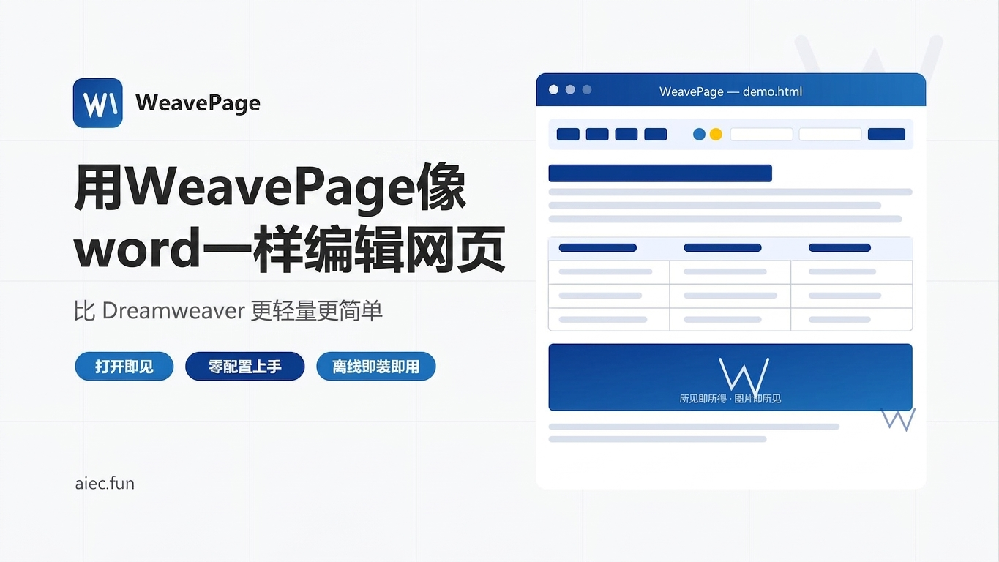
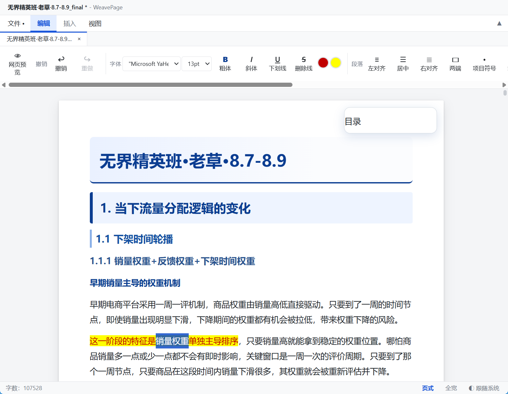
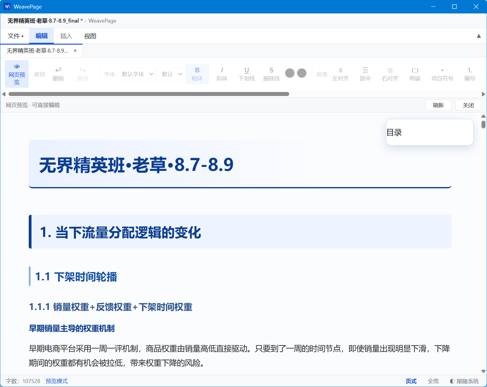
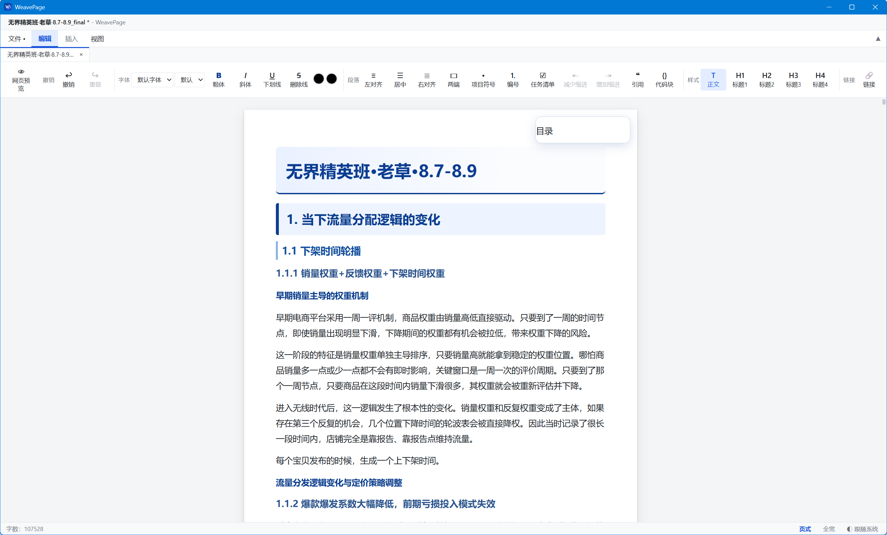

<p align="center">
  
</p>

<p align="center">
  <a href="https://github.com/kizemo/weavepage/releases"></a>
  <a href="https://github.com/kizemo/weavepage"></a>
  <a href="#"></a>
  <a href="#"></a>
</p>

<p align="center">
  <b>像 Dreamweaver 一样「织」网页 —— 但更轻、更简单、更现代。</b><br/>
  打开任意 HTML 文件，立即呈现完整的 CSS 样式与 JS 动态效果。<b>编辑界面就是最终效果。</b>
</p>

<p align="center">
  
</p>

---

## What is WeavePage?

WeavePage（织页）是一款 **Windows 桌面网页编辑器**。传统网页编辑器要么笨重复杂（Dreamweaver 时代的老工具），要么依赖浏览器和网络（在线编辑器）；WeavePage 把「所见即所得」带回本地桌面：双击安装、打开即编辑，零配置、零学习成本。

|  | Dreamweaver | 在线编辑器 | **WeavePage** |
|---|---|---|---|
| 启动速度 | 慢（数秒） | 依赖浏览器 | **秒开** |
| 网络依赖 | 无 | **必须联网** | **完全离线** |
| 学习成本 | 高（专业工具） | 中 | **零（像 Word 一样）** |
| 文档 CSS 渲染 | ✓ | 部分 | **打开即见 + 可编辑** |
| 安装 | 数 GB | 无需 | **205MB 双击即装** |
| JS 动态效果 | ✓ | ✓ | **预览可见 + 可编辑** |

---

## ✨ Features

### 所见即所得

- 打开 HTML 文件，**文档 CSS 自动注入编辑区** —— 标题、字体、颜色、排版与最终页面完全一致
- **网页预览模式**：完整渲染 CSS 样式与 JS 动态效果（悬浮目录、平滑滚动、交互组件），并且**可直接在预览中编辑**，改动实时同步回编辑器
- 外部 CSS / JS / 图片**自动内联**为自包含文档，保存重开效果不丢

### 像 Word 一样编辑网页

- **Word 风格功能区**：字体、字号（9-36pt）、颜色、高亮、对齐、列表、引用、代码块
- 选中文字时，功能区**自动显示该文字的实际字体 / 字号 / 颜色**
- **文字颜色 / 高亮**：弹出色板集成「更多颜色」（系统色盘）+「最近使用」色组（各 8 个，自动 LRU）
- **打开最近**：文件菜单「打开最近 ▶」二级菜单，默认保存最近 10 个工作文档，子菜单尾部一键清除
- **表格**：5×5 网格选择器一键插入，行列增删
- **图片**:**拖拽**本地图片到任意位置 / **Ctrl+V 粘贴**截图 → 自动落盘到 `<html_dir>/img/` 并以相对路径嵌入(SHA-256 去重,同名图不重复存储)

### 面向开发者的细节

- **源码视图**：查看 / 编辑完整页面代码（head、CSS、JS 全部可见），Ctrl+S 直接保存
- **块级源码编辑**：右键任意块 → 右侧边栏编辑该块 HTML，可导航父块 / 子块 / 兄弟块
- **外联资源侧边栏**：网页引用的 CSS / JS 自动列出，点击即在新标签打开编辑
- **多标签页**：同时打开 HTML / CSS / JS / 文本文件，独立状态自由切换
- **页式 / 全宽视图**、**主题三态**（浅色 / 深色 / 跟随系统），重启保持

### 可视块选择与容器样式(v2.3.0)

- **可视块选择**:在编辑区 hover 任意块元素 → 浅虚线 + tag 提示(灰色小角标);单击 → 蓝实线 + breadcrumb 角标;Esc 脱选;**Ctrl+↑/↓** 在父块 / 子块间逐层 drill
- **容器样式编辑**:Ribbon 编辑 tab 末尾「容器」组,7 个控件:背景色 / 边框色 / 边框宽(0/1/2/4/8px)/ 边框样式(solid/dashed/dotted/none)/ 圆角(0/4/8/16px)/ 内边距(0/8/16/24/32px 单一值,四边一致)
- **⭐ 提升为默认样式**:选中块后点 ⭐「提升」按钮,把当前块的 inline 样式抽成 head CSS `tagName { ... }` 规则,文档中所有同名标签共享样式。多于 1 个同标签时弹确认(N=1 时提示无需提升)
- **关闭未保存弹窗**:点 X / Alt+F4 / Ctrl+Q 时若 dirty tab,弹出保存确认对话框(可勾选取消勾选个别 tab);无 dirty 直接退出

### 轻量可靠

- 安装包自带 **WebView2 离线运行时** —— 全新电脑、无网络双击安装直接使用
- 基于 Tauri，单进程低占用

## 📸 界面预览

| 编辑视图（所见即所得） | 网页预览（完整 CSS/JS 效果） |
|:---:|:---:|
|  |  |

| 主界面（Word 风格功能区 + 多标签页） |
|:---:|
|  |

## 🚀 安装

1. 前往 [Releases](https://github.com/kizemo/weavepage/releases) 下载 `WeavePage_3.0.0_x64-setup.exe`
2. 双击安装（自动安装 WebView2 运行时，全程无需联网）
3. 从开始菜单启动 **WeavePage**

> **系统要求**：Windows 10/11 x64

### 🔐 校验

```
# NSIS 安装包 (254 MB)
sha256: f37155594a3bad985cc59d743c2e25385c904d21566c1d32aa206a2d790acfab

# NSIS 应用内升级包 (5.5 MB,仅供 WeavePage 应用内升级使用)
sha256: 5efbd68a4f26fe17706d2d7e9cedef11802e6ad9f0cdd6f7310cb85598a853de
```

Windows 验证：`certutil -hashfile WeavePage_3.0.0_x64-setup.exe SHA256`

## 📖 使用指南

| 你想做什么 | 怎么做 |
|---|---|
| 打开网页 | `文件 → 打开`（Ctrl+O）选择 HTML 文件，自动进入编辑视图 |
| 快速重开最近文档 | `文件 → 打开最近 ▶`（自动保存 10 个,一级子菜单带「清除」） |
| 编辑内容 | 直接在编辑区输入，用功能区调整格式，所见即所得 |
| 自定义文字/高亮颜色 | 功能区「文字颜色」/「高亮」弹窗 → 「更多颜色...」系统色盘；常用色自动入「最近使用」 |
| 可视块选择 | 编辑区 **hover** 任意块 → 浅虚线 + tag;**单击** → 蓝实线 + breadcrumb;**Esc** 脱选;**Ctrl+↑/↓** drill 父/子 |
| 改容器样式 | 先选中块 → Ribbon 编辑 tab 末尾「容器」组改背景/边框/圆角/内边距 |
| 提升为默认样式 | 选中块 → 容器组 ⭐「提升」按钮(多同 tag 时弹确认) |
| 查看真实效果 | 功能区「👁 网页预览」（或 F9），可直接在预览中改文字 |
| 同步编辑到预览 | 预览中按 **F5** 刷新 |
| 编辑整页源码 | `视图 → 源码视图`，head / CSS / JS 全部可改，Ctrl+S 保存 |
| 编辑单个块源码 | 编辑区**右键任意块** → 右侧面板改 HTML → 应用 |
| 编辑外联 CSS/JS | 左侧「外联资源」栏点击文件 → 新标签编辑 → Ctrl+S 写回 |
| 多文件同时处理 | Ctrl+N 新建、Ctrl+O 打开、Ctrl+W 关闭标签、Ctrl+Q 退出应用 |
| 插入表格/图片 | 「插入」选项卡：网格选择表格；图片按钮 / 拖入文件 / Ctrl+V 粘贴 |

**全部快捷键**：`Ctrl+N/O/S/Shift+S/W/Q` 文件操作 · `Ctrl+Z/Y` 撤销重做 · `F5` 刷新预览 · `F9` 切换编辑/预览

## 🛠 Development Quickstart

```bash
# 环境要求：Node.js ≥ 20、Rust ≥ 1.77、pnpm
pnpm install        # 安装依赖
pnpm tauri dev      # 开发模式运行
pnpm build          # 前端构建（tsc + vite）
pnpm release        # 打包安装程序到 release/ 目录
```

## 🏗 技术栈

| 层 | 技术 |
|---|---|
| 桌面壳 | [Tauri v2](https://tauri.app)（Windows · WebView2） |
| 前端 | React 19 + TypeScript + Vite |
| 编辑器 | [Tiptap 3](https://tiptap.dev)（ProseMirror） |
| 包管理 | pnpm |

## 📁 项目结构

```
├── src/                    # React 前端
│   ├── App.tsx             # 应用装配（多标签/文件操作/模式切换/快捷键）
│   ├── App.css             # CSS 变量主题系统 + 功能区/编辑区样式
│   ├── extensions/         # 自定义扩展（字号/HTML 保真）
│   ├── utils/              # 字体常量表/HTML 格式化
│   └── components/         # 菜单栏/功能区/标签栏/侧边栏/状态栏/块源码面板
├── src-tauri/              # Tauri 壳（capabilities/图标/打包配置）
├── assets/                 # logo、示例文档与界面截图
└── scripts/                # 发布脚本（构建后复制安装包到 release/）
```

## 💬 反馈与支持

- 遇到问题或有功能建议，欢迎在 [Issues](https://github.com/kizemo/weavepage/issues) 提出
- 演示文档见 [`assets/demo/demo.html`](assets/demo/demo.html)，下载后可直接用 WeavePage 打开体验

## 📋 变更日志

### v3.0.0 — 2026-09-10
- **新增 图片拖拽**:从资源管理器拖本地图片到 WeavePage 任意位置(编辑器 / Ribbon / Sidebar),自动落盘 + 插入文档。基于 Tauri 2.x `getCurrentWebviewWindow().onDragDropEvent` IPC(注意:DOM `dragover` / `drop` 在 Tauri 2.x 被完全拦截,改用 IPC 转发)
- **新增 图片粘贴**:编辑器聚焦按 Ctrl+V,自动插入剪贴板图片(截图工具 / 浏览器复制)。SHA-256 去重,同内容图片不重复存储
- **重构 `processImageBytes`**:按钮选文件 / 拖拽 / 粘贴三个入口共用一份 SHA-256 + sidecar 写入逻辑
- **清理**:移除 v2.3.8/v2.3.9 调试用 `console.log` 与 no-op 的 iframe DOM 监听器

### v2.3.7 — 2026-09-02
- **修复 图片全流程**:sidecar `<html_dir>/img/` 目录 + iframe data URL 渲染 + input 事件反向剥 data URL,源视图与保存文件均为干净相对路径
- **修复 视图同步**:`editorSrcDoc` useMemo deps 加 `mode` + `filePath` + `srcDocVersion`,切源码/编辑视图不丢编辑
- **新增 撤销/重做**:`Ctrl+Z` / `Ctrl+Y` / `Ctrl+Shift+Z` 走 500ms 防抖历史栈(上限 50)
- **修复 通用 Delete**:`blockSelectionActive` flag 区分选区态 / 编辑态,任意元素可删(void 元素 IMG/BR/HR/INPUT 特判)
- **修复 base 累积剥除** + iframe overlay 挂 documentElement + blockSelectorScript 移 head

### v2.3.0 — 2026-08-28
- **新增 可视块选择(Goal 1)**:编辑器内 hover 任意块元素显示浅虚线 + tag 提示;单击选中后蓝实线 + breadcrumb;Esc 脱选;Ctrl+↑/↓ 在父块 / 子块间 drill
- **新增 容器样式编辑(Goal 2)**:Ribbon 编辑 tab 末尾追加「容器」组(背景 / 边框色 / 边框宽 0/1/2/4/8 / 边框样式 solid/dashed/dotted/none / 圆角 0/4/8/16 / 内边距 0/8/16/24/32 单一值)+ ⭐「提升」按钮把选中块 inline 样式抽成 head CSS `<style id="weavepage-block-style">` 命名块的 `tagName { ... }` 规则,跨多同 tag 块共享(N>1 时弹确认,N=1 提示无需)。⭐ 提升后必须清原 inline(inline CSS 优先级 > head tagName 规则)
- **新增 关闭未保存弹窗(Goal 3)**:应用关闭时若 dirty tab → 自定义 React 模态(复用 modal-mask 风格)列出 dirty tabs(checkbox 默认全选,可单独取消)+ 三按钮「保存选中」/「不保存」/「取消」
- **重构 块选择架构**:iframe 内 srcdoc 注入 `<script>` 自渲染 hover/selected overlay(在 iframe.body 内 append),通过 `postMessage` 跟 outer 通信。规避 Tauri WebView2 + Windows 11 跨 frame 监听不可靠问题(经多轮真机测迭代修复)
- **修复 退出 race condition**:`std::process::exit(0)`(Rust `exit_app` command)+ `isClosingRef` + iframe 内 Ctrl+Q 转发,确保 X / Alt+F4 / 菜单退出 / Ctrl+Q / Ctrl+W 全部路径生效
- **修复 退出保存丢内容**:iframe.onLoad 的 input listener 同步 `body` 到 docs(之前只更新 `isModified`,`docs[i].body` 一直 stale,`saveDocById` 用 stale body 写盘 → 文件空)
- **改进 容器组 UI**:select 控件前加 hint label(边框宽 / 样式 / 圆角 / 内边距),参照 RibbonHome 段落组的 `ribbon-select-with-hint` 模式
- **拆分 菜单"关闭标签" / "退出"**:符合主流编辑器惯例 — Ctrl+W 关 tab,Ctrl+Q / 文件菜单"退出"关应用

### v2.2.0 — 2026-08-27
- **新增 设计顶级 Ribbon Tab**:把 v2.1.0 设计按钮从 ribbon「编辑」tab 内的 dropdown 浮层提升为顶级 tab(与「编辑」「插入」平级)。菜单栏顺序:文件 / 编辑 / 插入 / 设计 / 视图 / 帮助
- **重构 缩略图横排条**:9 张缩略图(默认 + 8 套预设)改为 ribbon 区域内的横向 scrollable 一条,90×60px,不再 dropdown 浮层。删除 portal/anchor 浮层逻辑,净 -50 行
- **拆分 DesignThumb / DesignStrip**:DesignThumb 从 RibbonDesign.tsx 拆出为独立可复用组件;DesignStrip 作为横向 scrollable 容器;RibbonDesign.tsx 整体删除(200 行 portal+anchor 浮层全部作废)
- **改进 source 视图禁用**:`设计` tab 在源码模式下 disabled + tooltip「请切换到编辑视图」(沿用 v2.1.0 行为,位置从 ribbon 内提升到顶级 tab)
- **沿用 v2.1.0 设计功能**:8 套预设 CSS / 持久化(`<style data-weavepage-design>`)/ WYSIWYG / 目录样式跟随主风格 全部不动

### v2.1.0 — 2026-08-26
- **新增 文档设计子菜单**:Ribbon「设计」按钮组,弹出 16:9 缩略图面板(8 套预设 + 默认)。8 套风格:**经典学术 / 现代简约 / 文艺书卷 / 科技感 / 商务正式 / 柔雅 / 薄荷清新 / 复古印刷**;每张缩略图用 iframe srcdoc 隔离 CSS,真实显示各自设计效果
- **新增 设计样式持久化**:选中的 design CSS 注入 `<style data-weavepage-design="X">` 到 `<head>`,写入 HTML 文件本身;保存重开自动恢复;目录样式跟随主风格
- **修复 applyDesign 失效**:`sh.head` 是 `<head>` 的 innerHTML,旧 `replace("</head>", ...)` 永远找不到,改为追加到 head 末尾
- **修复 9 张缩略图 CSS 冲突**:原 unscoped `<style>` 9 张共存时 last-wins,全部一样;改用 iframe srcdoc 各自隔离

### v0.1.2 — 2026-08-16
- 新增 文件菜单「打开最近 ▶」二级子菜单，默认保存最近 10 个工作文档，附「清除」按钮
- 新增 文字颜色 / 高亮弹出集成「更多颜色...」原生系统色盘(WebView2)
- 新增 「最近使用」色组，自动保留最近 8 个文字色 + 8 个高亮色（LRU，hex 归一化）
- 数据持久化于 `%APPDATA%\fun.aiec.weavepage\`（`recent.json` + `recent-colors.json`）
- 重构 提取 `loadDocFromPath` 共用 `openFile` / `openResource` / `打开最近` 三处读取逻辑

### v0.1.1 — 2026-08-15
- 更换 织纹 W 品牌应用图标（窗口 / 安装包 / 任务栏）

### v0.1.0 — 2026-08-14
- 发布 初版：所见即所得 + Word 功能区 + 多标签 + 预览/源码/块编辑 + 外联资源侧边栏

## 许可

© 2026 [aiec.fun](https://aiec.fun) · WeavePage 织页
